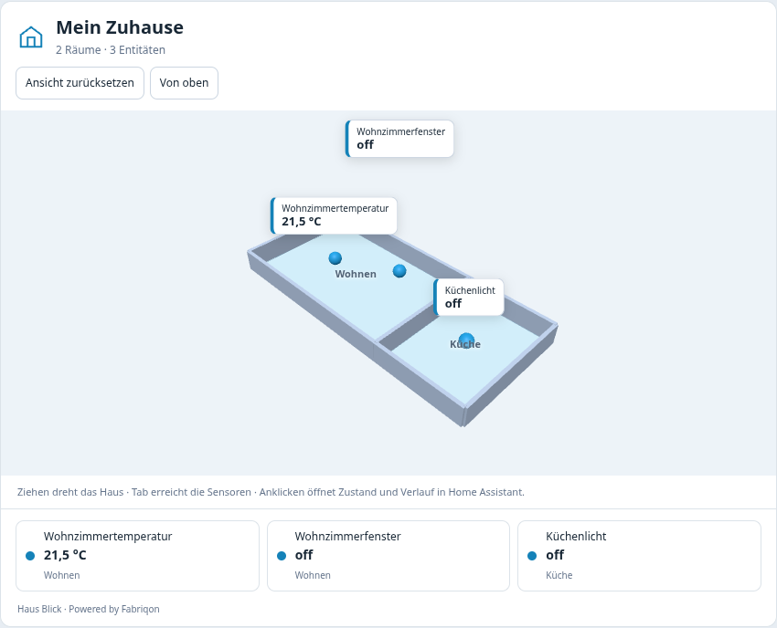

# Haus Blick

**Vorhandene Home-Assistant-Entitäten in deinem 3D-Hausmodell.** Eine HACS-Dashboard-Karte mit dem öffentlichen [Fabriqon SDK](https://github.com/fabriqon-de/sdk).

Haus Blick startet neu als reine Frontend-Karte. Es benötigt keinen eigenen Container, keine Python-Integration, Datenbank oder Broker-Zugangsdaten. Die Zustände kommen aus der bestehenden Home-Assistant-Sitzung. HACS und ein WebGL-fähiger Browser genügen; HA OS ist dafür nicht erforderlich.



## Entwicklungsstand 0.1.0

- Rechteckige Räume in Metern als offenes 3D-Hausmodell konfigurieren.
- Bestehende HA-Entitäten Räumen und Positionen zuordnen; Werte und Einheiten im Modell und in einer zugänglichen Liste sehen.
- Zustandsänderungen übernehmen, ohne Kamera oder WebGL-Viewer neu zu erzeugen.
- Aktive Kontakte/Lichter sowie fehlende, unbekannte und nicht verfügbare Zustände unterscheiden.
- Anklicken öffnet den normalen HA-Entitätsdialog mit vorhandenen Bedienelementen und Verlaufsdaten. Ein Verlauf setzt eine entsprechende HA-Aufzeichnung voraus.
- Visueller Karteneditor, Touch-/Kamerabedienung und Entitätsliste als WebGL-Fallback.

Automatisierte Browser-Tests verwenden den echten SDK-Viewer mit simuliertem Home Assistant. Reale HA-/HACS-Installation und Companion Apps sind noch nicht abgenommen. Kein automatisches Erkennen des Hauses, keine externen 3D-Dateien, kein DXF-/IFC-Import und kein Wandzeichen-Editor werden behauptet.

## Installation

1. In HACS über das Menü **Benutzerdefinierte Repositories** öffnen.
2. `https://github.com/fabriqon-de/haus-blick` mit Kategorie **Dashboard** (ältere Oberflächen: Frontend) hinzufügen und herunterladen. Das ist noch kein offizieller HACS-Verzeichniseintrag.
3. Dashboard-Ressource prüfen: `/hacsfiles/haus-blick/haus-blick.js`, Typ **JavaScript-Modul**. Falls nicht automatisch vorhanden, einmalig hinzufügen.
4. Browser vollständig neu laden und über den Kartenwähler **Haus Blick** hinzufügen. Alternativ YAML:

```yaml
type: custom:haus-blick-card
title: Mein Zuhause
rooms:
  - id: wohnen
    name: Wohnen
    x: 0
    z: 0
    width: 6
    depth: 4
entities:
  - entity: sensor.wohnzimmer_temperatur
    room: wohnen
    x: 2
    z: 1.5
  - entity: binary_sensor.wohnzimmer_fenster
    room: wohnen
    x: 4.5
    z: 0.5
```

IDs durch tatsächlich vorhandene HA-Entitäten ersetzen. Der Standardgrundriss ist ein konfigurierbares Beispiel, keine automatisch erkannte Hausstruktur.

[Installation und Fehlersuche](docs/installation.md) · [Konfiguration](docs/configuration.md) · [Tests und reale Abnahme](docs/testing.md) · [Architektur](docs/architecture.md) · [Roadmap](docs/roadmap.md).

## Entwicklung

Node 22/24 und npm verwenden:

```sh
npm ci
npm run check
npm test
npm run build
npm run check:package
npx playwright install chromium
npm run test:browser
```

Vorhandenes Chromium: `CHROMIUM_PATH=/usr/bin/chromium npm run test:browser`. Nach dem Build öffnet `npm run preview` die lokale Entwicklung; `/tests/fixtures/` ist der ausdrücklich simulierte HA-Host.

`dist/haus-blick.js` ist absichtlich eingecheckt, damit HACS ohne GitHub Release vom Hauptzweig installieren kann. Nach Änderungen neu bauen; CI prüft die reproduzierbare Distribution. SDK, three.js und vollständige MIT-Hinweise sind enthalten. Keine CDN-Abhängigkeiten oder nachzuladenden JS-Chunks.

[CONTRIBUTING](CONTRIBUTING.md) · [SECURITY](SECURITY.md) · [Changelog](CHANGELOG.md).

MIT. [THIRD_PARTY_NOTICES.md](THIRD_PARTY_NOTICES.md) enthält die unveränderten Hinweise des SDK und von three.js, die auch im Bundle stehen. Das private Fabriqon Studio gehört nicht zu diesem Projekt.
